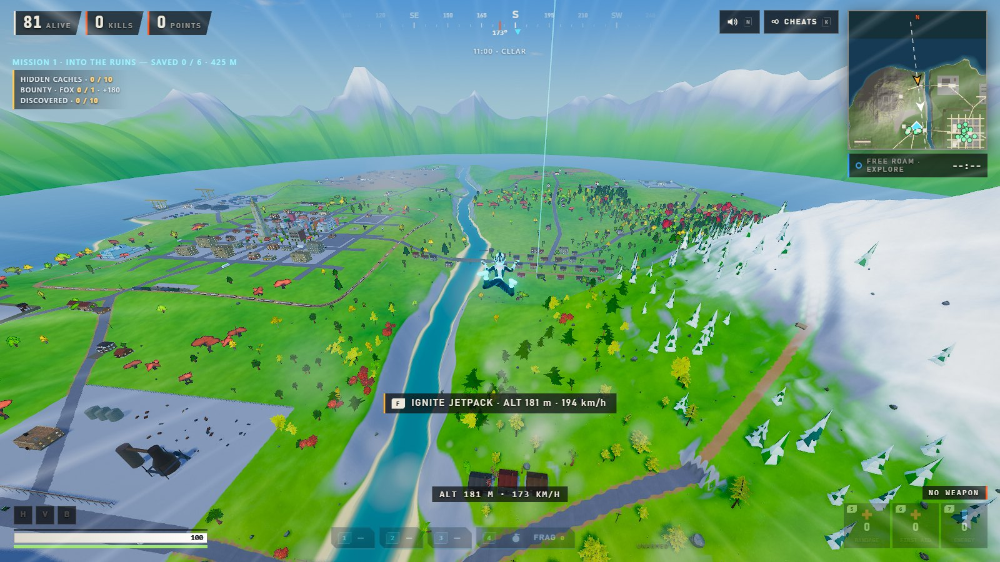
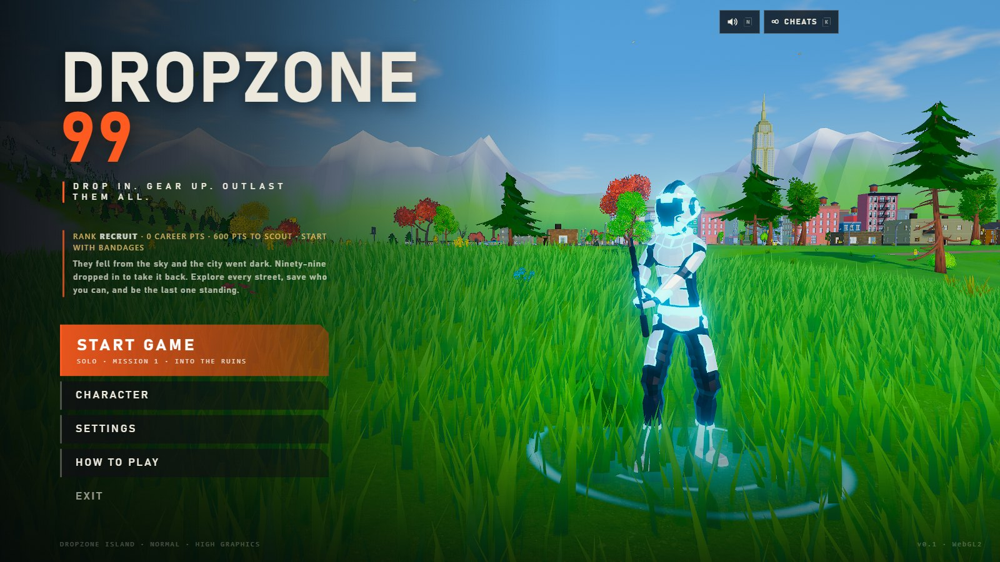
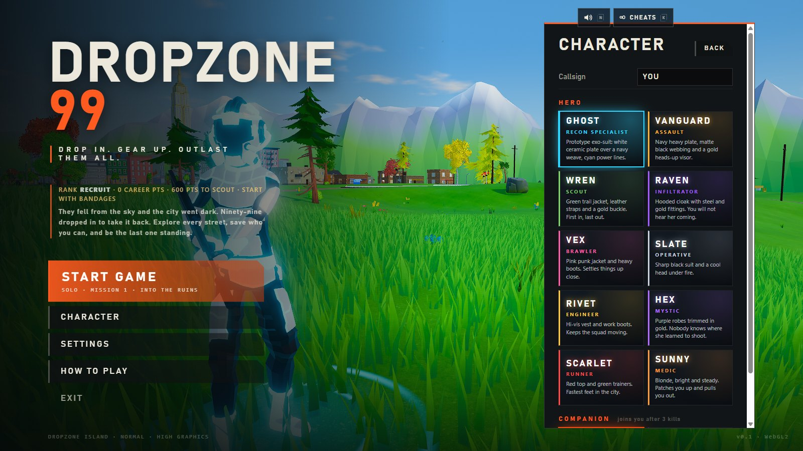
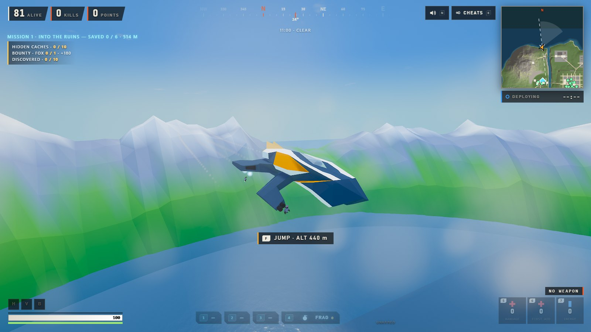
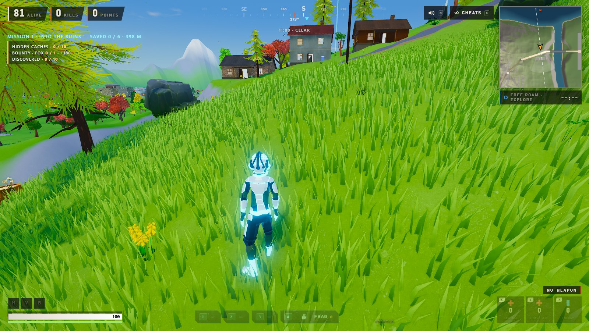
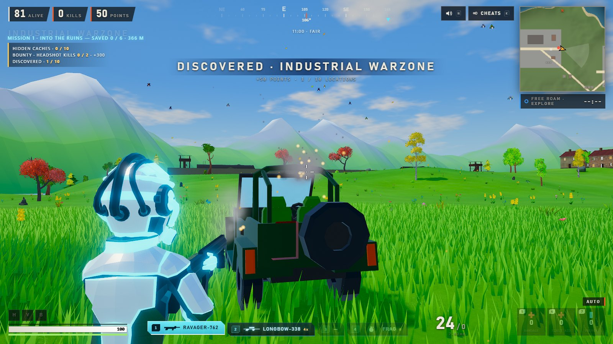
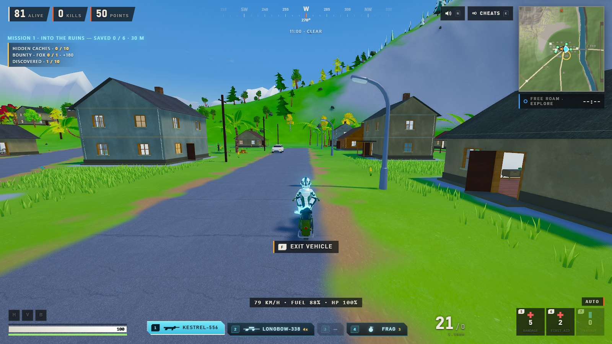
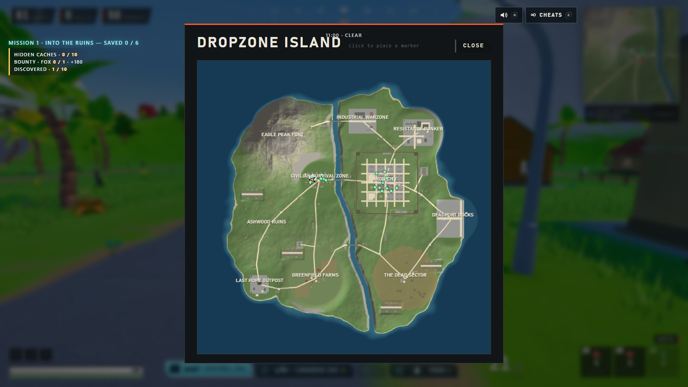

<div align="center">

# DROPZONE 99 · Free 3D Battle Royale in Your Browser

**99 drop in. One survives.**

A third-person battle royale you play right in the browser. No download, no install, no account.
Skydive onto an island, loot weapons, drive jeeps and tanks, and outlast 98 bots.

### ▶ [PLAY NOW: sharpwizard.github.io/dropzone-99](https://sharpwizard.github.io/dropzone-99/)

[](https://sharpwizard.github.io/dropzone-99/)
[](https://www.anthropic.com/claude)
[](https://threejs.org/)
[](https://github.com/SharpWizard/dropzone-99/stargazers)



</div>

## What is DROPZONE 99?

DROPZONE 99 is a **free browser battle royale game** inspired by mobile and PC battle royales such as **Free Fire** and **PUBG**: you jump out of a plane over a big island, land wherever you like, pick up guns and medical supplies, find a vehicle and fight to be the last one standing.

The whole game runs in a single web page with **Three.js and WebGL2**. The terrain, buildings, textures and all sound are generated in code.

**Built with Claude.** The game was designed and programmed together with **Claude Opus 5.5** (Anthropic's AI model, used through Claude Code): the game loop, rendering pipeline, bot AI, vehicle physics, missions, UI and deployment were all written in conversation with the model.

> DROPZONE 99 is an independent fan project. It is not affiliated with, endorsed by or connected to Garena (Free Fire), KRAFTON (PUBG) or any other publisher. All names, characters, art and code here are original or come from the free asset packs listed in [CREDITS.md](CREDITS.md).

## Features

- 🪂 **Plane drop, freefall and jetpack landing**: choose your landing spot and dive for it
- 🏝️ **One big island** with 10 locations: Iron City, Deadport Docks, Industrial Warzone, Eagle Peak Fort, Resistance Bunker, Ashwood Ruins, Greenfield Farms, The Dead Sector, Last Hope Outpost and the Civilian Survival Zone
- 🔫 **7 guns** (assault rifles, SMG, DMR, sniper, shotgun, pistol) with scopes, suppressors, fire modes, recoil, damage falloff and headshots, plus grenades and melee tools
- 🚙 **Drivable vehicles**: jeeps, sedans, pickups, trucks, motorcycles, a supercar, an ambulance and tanks, all with fuel
- 🤖 **98 AI opponents** that hear gunshots, flank, use cover, call out targets and lay down suppressive fire. Four difficulty levels.
- 🧑‍🚀 **10 playable heroes** and a **companion** (dragon or ghost skull) that joins you after 3 kills
- 🎬 **Story campaign**: 6 missions with checkpoints, escort and patrol missions and a Titan boss
- ⭕ **Battle Royale mode**: the classic shrinking safe zone over 7 phases, last one alive wins
- 🌦️ **Day and night cycle and weather**, cascaded shadows, bloom, ambient occlusion, wind in the grass
- 🏆 **Career ranks** saved in your browser unlock a better starting loadout
- ⚙️ Graphics presets from LOW to ULTRA, auto-picked for your GPU, plus fully rebindable keys

## Gameplay: how a match works

### 1. Pick your hero

Choose from 10 heroes, each with their own outfit, and pick the companion that will fight beside you.




### 2. Ride the plane and jump

Every match starts on the drop plane flying across the island. The dashed line on the minimap is the flight path. Press **F** to jump when you are over the place you want to land.



### 3. Freefall and land

Hold **W** to dive faster and steer with the mouse. Altitude and speed are shown on screen. Below 400 m press **F** to fire the jetpack, which also opens on its own at 105 m, then steer it down to the ground.




### 4. Loot and fight

Walk over weapons, ammo, armour, bandages, first aid kits and energy drinks and press **F** (or open the inventory with **Tab**). Aim with the right mouse button and fire with the left. Bots react to sound, so a suppressor keeps you hidden longer.



### 5. Drive

Press **F** next to a vehicle to get in. Vehicles burn fuel, and jerrycans from the loot fill them up by 50%.



### 6. Read the map and survive

Open the map with **M** to see all ten locations and your mission objective, and click it to place a marker. In **Story** mode you follow the campaign, find hidden caches, collect bounties and save survivors. In **Battle Royale** mode (Settings) a white circle shrinks in 7 phases, the zone outside hurts more each phase, and the last player alive wins.



## Controls

| Action | Key |
|---|---|
| Move / look | WASD / mouse |
| Shoot / aim | LMB / RMB |
| Sprint / jump | Shift / Space |
| Crouch / prone | C / Z |
| Reload / fire mode | R / B |
| Pick up, interact, jump from plane, jetpack, enter and exit vehicles | F |
| Weapons / grenade | 1 2 3 / 4 |
| Bandage / first aid / energy drink | 5 / 6 / 7 |
| Switch shoulder / first-person | Q / V |
| Inventory / map | Tab / M |
| Sound on / off | N (or the speaker button, top right) |
| Cheats on / off | K (or the CHEATS button, top right) |
| Pause | Esc |

All keys can be rebound in Settings.

## Run it locally

```
git clone https://github.com/SharpWizard/dropzone-99.git
cd dropzone-99
npm install
npm run dev
```

Open http://127.0.0.1:5199/, or run `npm run build` and serve the `dist/` folder. Every push to `master` is built and published to GitHub Pages by `.github/workflows/deploy.yml`.

## How it works

| Part | What it does | Where |
|---|---|---|
| Game loop | Fixed state machine: boot, menu, play, paused | `src/core/Game.js` |
| Rendering | HDR pipeline with cascaded soft shadows, SSAO, bloom, ACES tone mapping, height fog, adaptive resolution | `src/rendering/` |
| World | Procedural terrain and water, 10 locations, towns, a railway with running trains, instanced vegetation | `src/terrain/`, `src/world/` |
| Bots | 98 bots. Those near you run full perception, path finding and ballistics; distant ones run a cheap abstract simulation so the frame rate holds. | `src/ai/` |
| Combat | Ray-cast shots with spread, recoil and range falloff, headshot zones, grenades | `src/combat/`, `src/weapons/` |
| Vehicles | Simple driving model with fuel, damage and enter/exit | `src/vehicles/` |
| Match | Plane path, drop, shrinking zone phases, story missions and checkpoints | `src/battleRoyale/` |
| Audio | Every sound is synthesised in code with Web Audio | `src/audio/` |

## Share it

If you enjoyed it, **star the repo ⭐** and share the link. It helps a lot.

`#battleroyale #browsergame #indiegame #threejs #webgl #gamedev #madewithclaude`

## Code layout

```
src/
  core/         game loop, state machine, settings, input
  rendering/    renderer (CSM shadows, sky, AO, bloom, grading), procedural textures, geometry batcher, effects
  assets/       GLB loader and instanced props
  world/        island data, buildings, the ten locations, vegetation
  terrain/      chunked terrain and water
  physics/      colliders, ground queries, ray casts
  characters/   character base, player, rigged soldier
  weapons/      weapon stats and models
  combat/       ballistics, damage, grenades
  ai/           navigation grid, bots
  vehicles/     driving model
  inventory/    items and loot
  battleRoyale/ plane, zone, match flow
  audio/        synthesised sound
  ui/           HUD, menus, inventory, map
public/assets/models/   GLB models (see CREDITS.md)
```

## Notes

- Ten playable heroes (src/characters/Heroes.js): the Astronaut (GHOST, the main hero) and SWAT trooper (VANGUARD) in custom colours, plus the eight women of the Ultimate Modular Women Pack in their own colours. All share one rig and clip set.
- Terrain, buildings, textures and all audio are generated in code. Characters, guns, vehicles, street props and furniture are GLB models from Poly Pizza; if a model fails to load the game falls back to a procedural version.
- Trees, bushes, rocks, grass, flowers and forest-floor plants come from the Stylized Nature MegaKit and Ultimate Stylized Nature Pack (CC0), grouped by biome in `NATURE` (src/assets/Assets.js). New packs are fetched with `node tools/fetch-bundles.mjs`, shrunk with `node tools/optimize-packs.mjs` and given light tree LODs with `node tools/build-lods.mjs`.
- Rendering (src/rendering/Gfx.js): HDR pipeline with cascaded soft shadows, MSAA + alpha-to-coverage foliage, SSAO, bloom, ACES and a vivid grade; atmospheric height fog with sun scattering replaces three's fog chunks for every material. Dynamic objects cast shadows only near the camera and rigs are culled out of view (`_dynLOD`); props are batched per 96 m cell with size-based draw distances. Settings has presets, output resolution and render scale; resolution adapts automatically while the window is focused.
- The grass field (Vegetation `_grass`) is one instanced draw call of blade clumps coloured from the terrain palette; counts per preset are in `PRESETS`.
- Photo textures are the 2K Poly Haven originals (`node tools/upgrade-textures.mjs` finds each source and downloads it); pack textures are 1024 px WebP (`TEX=1024 node tools/optimize-packs.mjs`).
- The town layer (src/world/Town.js) builds the City Pack downtown, small towns, roadside hamlets, the railway loop with its station and running trains, and the Eagle Peak fort.
- Floating pickups (first aid, bandages, water, food cans, an axe, a knife, a shovel and VIPER pistols) hover across the island; melee tools are carried in the hand and swung with the melee key. Wildlife (src/world/Animals.js) grazes the woods and the farm; hunting scores POINTS (bears fight back).
- STORY mode (default) is free roam: a hidden cache in every location, supply drops that fall near you, rolling bounties and location discovery (src/battleRoyale/Activities.js). BATTLE ROYALE mode in Settings brings back the shrinking zone.
- Vehicles burn fuel; jerrycans (loot) add 50%: stand next to the vehicle and press F, or use one from the inventory.
- Your companion (dragon or ghost skull) is picked in CHARACTER and joins after 3 kills; it never attacks civilians.
- The STORY campaign has six missions (STAGES in src/battleRoyale/Match.js). Each mission's objective is marked on the compass, minimap and map and by a cyan light beam. Survivors you find follow you and count once you lead them into the Civilian Survival Zone; mission 3 sends three Swarm patrols to the bunker, and the hive cores, the Titan and the Citadel points are guarded. Reaching a mission saves a checkpoint, and the menu offers CONTINUE from it.
- Loading: models download while textures are synthesised, and three.js is a separate cached chunk (vite.config.js). On LOW and MEDIUM, shadow maps refresh every other frame.
- CHEATS (top-right button or K): unlimited health (no damage), a magazine that never empties, endless grenades and meds, full stamina, jetpack and vehicle fuel. A match played with cheats on is not banked into the career.
- Career (src/core/Career.js) saves lifetime points in the browser; seven ranks unlock a better starting loadout.
- Hostiles are the alien Swarm (Ultimate Monsters Bundle) with guns from the Ultimate Guns Pack; civilians flee them.
- Models are meshopt-compressed (`node tools/compress-meshes.mjs`); the loader decodes and unpacks them. Shaders compile during loading and again in parallel during the plane ride, so arriving somewhere new does not stall.
- Difficulty (EASY, NORMAL, HARD, EXPERT in `DIFFS`, src/core/Settings.js) sets the bots' aim, hearing, field of view, squad callouts, flanking, search time, suppressive fire, dodging and how strongly they focus on you.
- 98 bots are simulated. Those near you run full perception, path finding and ballistics; distant ones use a cheaper abstract simulation.
- `window.__dz` exposes the game object for debugging (`__dz.timeScale = 8` fast-forwards a match).
